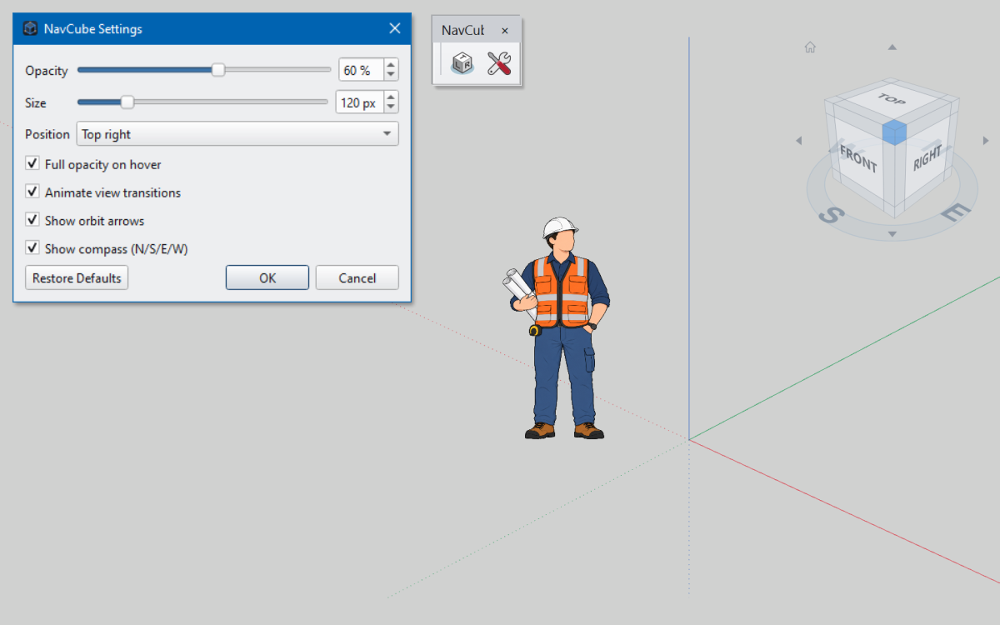

# NavCube Overlay Plugin for IngeTrazo (`igz_navcube`)

An interactive, CAD-style 3D Navigation Cube overlay for **IngeTrazo**, inspired by standard viewport navigation tools found in modern CAD and BIM applications like Autodesk AutoCAD and Revit.

---
- **Author:** Ezequiel M. Rezende
- **Date:** 2026-11-27
- **Version:** 1.0.1
- **License:** [GPL-3.0-or-later](https://www.gnu.org/licenses/gpl-3.0.html)
  (same as IngeTrazo — see [LICENSE](https://github.com/ingelibre/ingetrazo/blob/main/LICENSE))

---



---

## Key Features

* **Interactive 3D Viewport Cube**: Click on any face, edge, or corner of the 3D cube to instantly reorient the 3D camera to standard orthographic or isometric perspectives (e.g., Top, Front, Right, Isometric views).
* **Dynamic Compass Ring & Cardinal Directions**: Integrated bottom compass ring supporting smooth $Z$-axis yaw rotation by dragging, along with clickable cardinal direction letters (`N`, `S`, `E`, `W`) scaled dynamically with the cube.
* **Orbit Arrows & Home View Button**: Quick-access directional arrows for incremental $90^\circ$ orbits and a Home button to instantly reset to the default isometric view.
* **Live Configuration Dialog**: Adjust opacity, size, corner position, hover opacity behavior, animated transitions, orbit arrows, and compass visibility in real time with live preview and instant rollback on cancel.
* **Seamless Menu Integration**: Adds a toolbar button and automatically embeds a dedicated submenu inside the host application's **Extensions** menu with synchronized check states.
* **Multi-Language Support (i18n)**: Automatic language detection and dynamic switching for English (`en-US`), Portuguese (`pt-BR`), German (`de`), Spanish (`es`), French (`fr`), Italian (`it`), and Simplified Chinese (`zh`).

---

## Directory Structure

```text
igz_navcube/
│ __init__.py
│
├─── core
│  ├─── core.py
│  ├─── dialogs.py
│  ├─── igz_navcube.py
│  ├─── navcube_math.py
│  └─── overlay.py
│
├─── i18n
│  ├─── de.json
│  ├─── en-US.json
│  ├─── es.json
│  ├─── fr.json
│  ├─── it.json
│  ├─── pt-BR.json
│  └─── zh.json
│
└─── icons
   ├─── navcube.svg
   └─── navcube_settings.svg
```

---

## Module Overview

| File / Folder | Description |
| :--- | :--- |
| `__init__.py` | Plugin entry point for IngeTrazo. Dynamically loads the core modules safely without namespace collision. |
| `core/core.py` | Core host adapter (`IngeTrazoHost`), settings persistence via `QSettings`, and multi-language loading logic. |
| `core/igz_navcube.py` | Plugin life-cycle management (`setup`, `teardown`), toolbar creation, and **Extensions** menu integration. |
| `core/overlay.py` | High-performance frameless PySide6 translucent widget (`NavCubeOverlay`) handling custom 3D rendering, compass drawing, mouse interactions, dragging, and camera interpolation. |
| `core/dialogs.py` | `SettingsDialog` offering interactive sliders, dropdowns, and checkboxes for real-time live preview. |
| `core/navcube_math.py` | Pure-Python vector, quaternion, projection, and matrix transformation library without PySide dependencies. |
| `i18n/*.json` | Internationalization dictionary files mapping translation keys for all UI components. |
| `icons/` | Custom vector icons (`SVG`) for the toolbar, menu items, and dialog buttons. |

---

## Installation & Setup

1. Copy or clone the `igz_navcube` directory into your IngeTrazo plugins directory:
   ```path
   %APPDATA%\IngeTrazo\plugins\igz_navcube
   ```
2. Launch **IngeTrazo**. The plugin auto-detects the active 3D viewport and attaches the NavCube overlay to the selected corner.
3. Access controls via the **NavCube** toolbar button or under **Extensions > NavCube** in the main menu bar.

---

## Configuration Options

| Setting | Range / Options | Default | Description |
| :--- | :--- | :--- | :--- |
| **Opacity** | $10\% - 100\%$ | $60\%$ | Idle transparency level of the cube overlay. |
| **Size** | $80\text{ px} - 300\text{ px}$ | $120\text{ px}$ | Dimension of the navigation cube bounding area. |
| **Position** | Top right, Top left, Bottom right, Bottom left | Top right | Viewport corner anchor. |
| **Full opacity on hover** | Enabled / Disabled | Enabled | Temporarily boosts overlay opacity to $100\%$ when hovered. |
| **Animate view transitions**| Enabled / Disabled | Enabled | Smoothly interpolates camera rotation using SLERP quaternions. |
| **Show orbit arrows** | Enabled / Disabled | Enabled | Toggles the 4 incremental orbit arrows around the cube. |
| **Show compass (N/S/E/W)** | Enabled / Disabled | Enabled | Toggles the bottom compass ring and cardinal directions. |

---


## License

Copyright © 2026 Ezequiel M. Rezende.

This plugin is free software: you can redistribute it and/or modify it under
the terms of the **GNU General Public License, version 3 or later** — the same
licence as [IngeTrazo](https://github.com/ingelibre/ingetrazo). See
[LICENSE](LICENSE) for the full text.