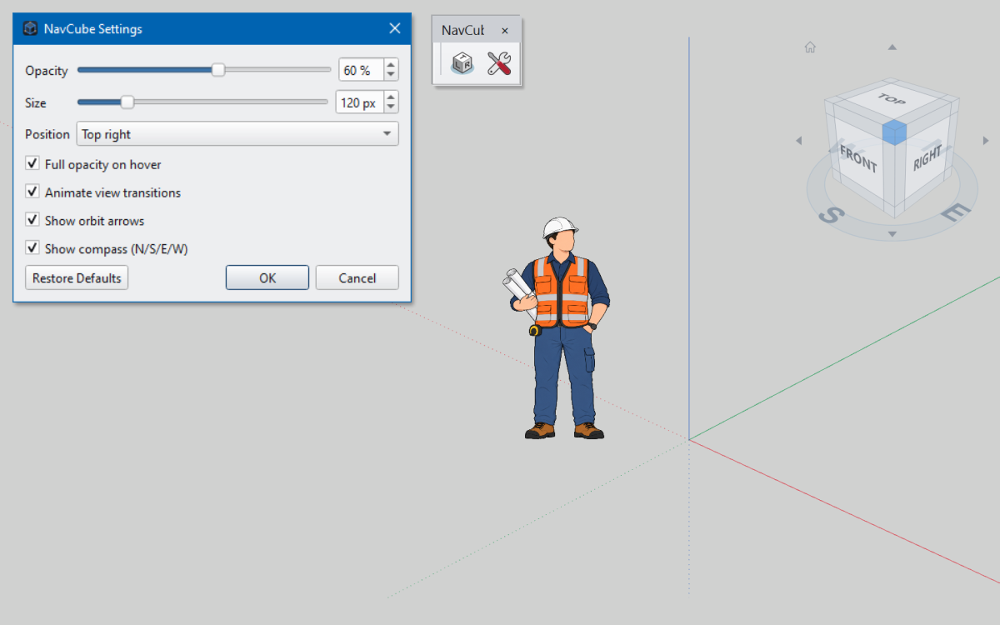

# Plugin NavCube Overlay para IngeTrazo (`igz_navcube`)

Um cubo de navegação 3D interativo no estilo CAD para o **IngeTrazo**, inspirado nas ferramentas padrão de navegação de *viewports* encontradas em aplicações CAD e BIM modernas, como o Autodesk AutoCAD e Revit.

---

- **Autor:** Ezequiel M. Rezende
- **Data:** 2026-11-27
- **Versão:** 1.0.1
- **Licença:** [GPL-3.0-or-later](https://www.gnu.org/licenses/gpl-3.0.html)
  (mesma do IngeTrazo — ver [LICENSE](https://github.com/ingelibre/ingetrazo/blob/main/LICENSE))

---



## Recursos Principais

* **Cubo de Viewport 3D Interativo**: Clique em qualquer face, aresta ou vértice do cubo 3D para reorientar instantaneamente a câmera 3D para perspectivas ortográficas ou isométricas padrão (ex.: vistas Superior, Frontal, Direita, Isométrica).

* **Anel de Compasso Dinâmico e Pontos Cardeais**: Anel de compasso inferior integrado com suporte a rotação suave no eixo $Z$ (guiñada/*yaw*) por meio de arraste, acompanhado por letras de direções cardeais clicáveis (`N`, `S`, `E`, `W`) que escalam dinamicamente com o tamanho do cubo.

* **Setas de Órbita e Botão de Vista Inicial (Home)**: Setas direcionais de acesso rápido para órbitas incrementais de $90^\circ$ e botão Home para redefinir instantaneamente a câmera para a vista isométrica padrão.

* **Diálogo de Configuração em Tempo Real**: Ajuste opacidade, tamanho, posição nos cantos da tela, comportamento de opacidade ao passar o mouse, transições animadas, setas de órbita e visibilidade do compasso com pré-visualização ao vivo e restauração imediata ao cancelar.

* **Integração Perfeita com Menus**: Adiciona um botão na barra de ferramentas e insere automaticamente um submenu dedicado no menu **Extensions** (Extensões) da janela principal, com estados de alternância (*toggle*) perfeitamente sincronizados.

* **Suporte Multilíngue (i18n)**: Detecção automática e alternância dinâmica de idioma para inglês (`en-US`), português do Brasil (`pt-BR`), alemão (`de`), espanhol (`es`), francês (`fr`), italiano (`it`) e chinês simplificado (`zh`).

## Estrutura de Diretórios

```
igz_navcube/
│ __init__.py
│
├─── core
│  ├─── core.py
│  ├─── dialogs.py
│  ├─── igz_navcube.py
│  ├─── navcube_math.py
│  └─── overlay.py
│
├─── i18n
│  ├─── de.json
│  ├─── en-US.json
│  ├─── es.json
│  ├─── fr.json
│  ├─── it.json
│  ├─── pt-BR.json
│  └─── zh.json
│
└─── icons
   ├─── navcube.svg
   └─── navcube_settings.svg
```

## Visão Geral dos Módulos

| Arquivo / Pasta | Descrição |
| ----- | ----- |
| `__init__.py` | Ponto de entrada do plugin para o IngeTrazo. Carrega os módulos internos de forma segura, prevenindo colisões de namespace no carregador dinâmico. |
| `core/core.py` | Adaptador do aplicativo hospedeiro (`IngeTrazoHost`), persistência de configurações via `QSettings` e sistema de carregamento de traduções. |
| `core/igz_navcube.py` | Gerenciamento do ciclo de vida do plugin (`setup`, `teardown`), criação da barra de ferramentas e integração com o menu **Extensions**. |
| `core/overlay.py` | Widget PySide6 translúcido e sem bordas (`NavCubeOverlay`) responsável pela renderização 3D customizada, desenho do compasso, interações de mouse, arraste e interpolação da câmera. |
| `core/dialogs.py` | Diálogo `SettingsDialog` com sliders, seletores e checkboxes interativos para pré-visualização em tempo real. |
| `core/navcube_math.py` | Biblioteca matemática em Python puro (vetores, quatérnios, projeções e matrizes de transformação) sem dependências do Qt. |
| `i18n/*.json` | Arquivos de dicionários de internacionalização contendo o mapeamento de chaves de tradução para a interface. |
| `icons/` | Ícones vetoriais (`SVG`) para a barra de ferramentas, menus e botões de configuração. |

## Instalação e Configuração

1. Copie ou clone a pasta `igz_navcube` para o diretório de plugins do IngeTrazo:

   ```text
   %APPDATA%\IngeTrazo\plugins\igz_navcube
   ```

2. Inicie o **IngeTrazo**. O plugin detectará automaticamente a *viewport* 3D ativa e fixará a sobreposição do NavCube no canto configurado.

3. Acesse os controles através do botão na barra de ferramentas do **NavCube** ou pelo menu **Extensions > NavCube** na barra de menus principal.

## Opções de Configuração

| Configuração | Intervalo / Opções | Padrão | Descrição |
| ----- | ----- | ----- | ----- |
| **Opacidade** | $10\% - 100\%$ | $60\%$ | Nível de transparência do cubo quando ocioso. |
| **Tamanho** | $80\text{ px} - 300\text{ px}$ | $120\text{ px}$ | Dimensão da área delimitadora do cubo de navegação. |
| **Posição** | Superior direita, Superior esquerda, Inferior direita, Inferior esquerda | Superior direita | Canto da *viewport* onde o overlay é ancorado. |
| **Opacidade total ao passar o mouse** | Habilitado / Desabilitado | Habilitado | Aumenta temporariamente a opacidade para $100\%$ ao passar o cursor sobre o plugin. |
| **Animar transições de vista** | Habilitado / Desabilitado | Habilitado | Interpola suavemente a rotação da câmera utilizando quatérnios (SLERP). |
| **Exibir setas de órbita** | Habilitado / Desabilitado | Habilitado | Alterna a exibição das 4 setas de órbita incremental ao redor do cubo. |
| **Exibir compasso (N/S/E/W)** | Habilitado / Desabilitado | Habilitado | Alterna a exibição do anel de compasso inferior e dos pontos cardeais. |


## Licença

Copyright © 2026 Ezequiel M. Rezende.

Este plugin é software livre: você pode redistribuí-lo e/ou modificá-lo sob os
termos da **GNU General Public License, versão 3 ou posterior** — a mesma
licença do [IngeTrazo](https://github.com/ingelibre/ingetrazo). Consulte o
arquivo [LICENSE](LICENSE) para o texto completo.